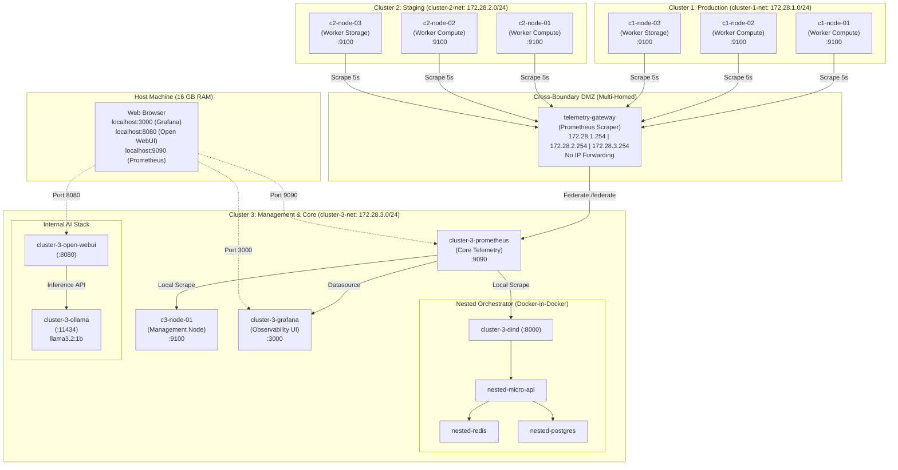

# Multi-Cluster Segmented Enterprise Infrastructure Simulation

A production-grade, lightweight Docker-based simulation of a multi-cluster, segmented enterprise infrastructure designed to run seamlessly on a 16 GB RAM laptop or workstation.

The system models:
* **Zero-Trust Network Segmentation:** Three isolated bridge networks (`cluster-1-net`, `cluster-2-net`, `cluster-3-net`) with strict inter-cluster communication denial.
* **Simulated Compute Fleet:** Dedicated lightweight VM nodes running `node-exporter` with simulated enterprise metadata.
* **Cross-Boundary Telemetry Gateway:** A multi-homed intermediary node that scrapes metrics from isolated clusters and exposes a federation endpoint without routing layer-3 IP traffic between networks.
* **Management, Orchestration & Observability (Cluster 3):** Core Prometheus federating metrics across boundaries, pre-configured Grafana dashboards, and a Docker-in-Docker (`dind`) nested container fleet running a multi-tier microservice stack (FastAPI/Python, Redis, PostgreSQL).
* **Local Enterprise AI Stack:** An internal Ollama inference server paired with Open WebUI running lightweight local LLMs (`llama3.2:1b` or `qwen2.5:1.5b`).

---

## 1. Architecture & Network Topology



---

## 2. Security & Network Isolation Model

1. **Strict Broadcast & Subnet Segmentation:**
   * `cluster-1-net` (`172.28.1.0/24`)
   * `cluster-2-net` (`172.28.2.0/24`)
   * `cluster-3-net` (`172.28.3.0/24`)
   * Each cluster operates on its own dedicated bridge with Docker DNS isolation.
2. **Zero-Trust Boundary Enforcement:**
   * Nodes in Cluster 1 **cannot resolve or ping** nodes in Cluster 2 or Cluster 3.
   * Nodes in Cluster 2 **cannot resolve or ping** nodes in Cluster 1 or Cluster 3.
   * Core Cluster 3 Prometheus **cannot scrape Cluster 1 or Cluster 2 nodes directly**; attempts to connect directly to `172.28.1.x:9100` are rejected.
3. **Application-Level Telemetry Gateway:**
   * The `telemetry-gateway` container has network interfaces in all three networks.
   * **No IP Routing:** Linux kernel IP forwarding (`/proc/sys/net/ipv4/ip_forward`) is disabled inside the container, preventing packet forwarding between bridges.
   * Metrics are pulled inside Cluster 1 and Cluster 2 at the application layer and exposed to Cluster 3 exclusively via Prometheus `/federate`.

---

## 3. Resource Allocation & Memory Budget

Every service specifies strict memory limits via `deploy.resources.limits.memory` to guarantee the entire multi-cluster topology fits comfortably within a 16 GB host machine:

| Component | Container Name | Memory Limit | Target Role |
| :--- | :--- | :--- | :--- |
| **Cluster 1 Nodes** | `c1-node-01` .. `c1-node-03` | 64 MB x 3 = 192 MB | Worker Compute & Storage VMs |
| **Cluster 2 Nodes** | `c2-node-01` .. `c2-node-03` | 64 MB x 3 = 192 MB | Staging Compute & Storage VMs |
| **Cluster 3 Node** | `c3-node-01` | 64 MB | Management Bastion VM |
| **Telemetry Gateway** | `telemetry-gateway` | 384 MB | Multi-homed Prometheus Scraper |
| **Primary Prometheus** | `cluster-3-prometheus` | 512 MB | Core Observability & Federation |
| **Grafana** | `cluster-3-grafana` | 384 MB | Observability UI & Dashboards |
| **DinD Orchestrator** | `cluster-3-dind` | 1,536 MB | Docker daemon + micro-api + Redis + Postgres |
| **Ollama AI Engine** | `cluster-3-ollama` | 3,072 MB | Local LLM Inference (`llama3.2:1b`) |
| **Open WebUI** | `cluster-3-open-webui` | 768 MB | Web Chat Interface |
| **Total Memory Limit**| **All 11 Containers** | **~7.1 GB** | **Leaves >8 GB free on a 16 GB host** |

---

## 4. Repository Structure

```
j-hat/
├── docker-compose.yml                     # Main topology orchestration
├── .env.example                           # Configuration defaults (models, ports)
├── README.md                              # Full architectural documentation
├── images/
│   └── simulated-node/                    # Custom lightweight Alpine node
│       ├── Dockerfile                     # Alpine 3.20 + official node_exporter + tools
│       └── entrypoint.sh                  # Injects enterprise node metadata metrics
├── configs/
│   ├── prometheus/
│   │   ├── gateway-prometheus.yml         # Scrapes C1 & C2 isolated nodes
│   │   └── primary-prometheus.yml         # Federates from gateway + scrapes C3
│   ├── grafana/
│   │   ├── provisioning/
│   │   │   ├── datasources/prometheus.yml # Pre-configured Prometheus datasource
│   │   │   └── dashboards/dashboards.yml  # Auto-import provider configuration
│   │   └── dashboards/
│   │       ├── enterprise-infrastructure-overview.json # Multi-cluster topology board
│   │       └── cluster-telemetry-drilldown.json        # Per-node metric drilldown
│   └── dind/
│       ├── docker-compose.yml             # Nested fleet compose file
│       ├── entrypoint-dind.sh             # Auto-bootstraps nested stack inside DinD
│       └── micro-api/                     # Python 3.11 web service with metrics
│           ├── app.py
│           ├── requirements.txt
│           └── Dockerfile
└── scripts/
    ├── up.sh                              # Linux / macOS / WSL startup script
    ├── up.ps1                             # Windows PowerShell startup script
    ├── down.sh                            # Teardown script (Bash)
    ├── down.ps1                           # Teardown script (PowerShell)
    ├── verify.sh                          # Automated verification suite (Bash)
    └── verify.ps1                         # Automated verification suite (PowerShell)
```

---

## 5. Quickstart Guide

### Prerequisites
* [Docker Desktop](https://www.docker.com/products/docker-desktop/) or Docker Engine (v24+) with Compose V2.
* Minimum 8 GB free RAM (recommended 16 GB total host RAM).

### Launching the Infrastructure

#### On Linux / macOS / WSL:
```bash
# Clone and enter directory
cd j-hat

# Make scripts executable and run
chmod +x scripts/*.sh
./scripts/up.sh
```

#### On Windows (PowerShell):
```powershell
# Enter directory and execute startup routine
cd j-hat
.\scripts\up.ps1
```

The startup script automatically:
1. Validates Docker engine and Compose availability.
2. Creates `.env` from `.env.example` if not already present.
3. Builds the custom simulated node image.
4. Starts all 11 multi-cluster containers across the 3 isolated bridge networks.
5. Waits for health checks across Primary Prometheus, Grafana, DinD, and Ollama.
6. Automatically checks and pulls the lightweight AI model (`llama3.2:1b`) into Ollama.

---

## 6. Access Endpoints & Port Mappings

Once running, access the services from your host machine browser:

| Interface | Host URL | Description | Default Credentials |
| :--- | :--- | :--- | :--- |
| **Grafana Dashboards** | [http://localhost:3000](http://localhost:3000) | Multi-Cluster Topology & Node Telemetry | `admin` / `admin` (or Anonymous Viewer) |
| **Open WebUI (AI Chat)** | [http://localhost:8080](http://localhost:8080) | Chat interface connected to local Ollama | No login required (`WEBUI_AUTH=False`) |
| **Primary Prometheus** | [http://localhost:9090](http://localhost:9090) | Core Prometheus query explorer & targets | None |
| **Ollama API** | [http://localhost:11434](http://localhost:11434) | Direct Ollama HTTP endpoint | None |

---

## 7. Sanity Check & Verification Suite

An enterprise-grade automated sanity check script is included in both Bash (`verify.sh`) and PowerShell (`verify.ps1`).

Execute the suite:
```bash
# Linux / macOS / WSL:
./scripts/verify.sh

# Windows PowerShell:
.\scripts\verify.ps1
```

### Verified Test Phases:
1. **Zero-Trust Network Isolation (Negative Tests):**
   * Confirms `c1-node-01` cannot resolve `c2-node-01` DNS.
   * Confirms `c1-node-01` cannot ping `c2-node-01` IP (`172.28.2.11`).
   * Confirms `c1-node-01` cannot ping Cluster 3 Prometheus IP (`172.28.3.90`).
   * Confirms `c2-node-01` cannot ping Cluster 1 IP (`172.28.1.11`).
   * Confirms Cluster 3 Prometheus cannot scrape Cluster 1 directly (`172.28.1.11:9100`), proving telemetry cannot bypass the gateway.
2. **Telemetry Gateway Multi-Homed Reachability:**
   * Confirms Cluster 1 nodes can reach the Gateway on `172.28.1.254`.
   * Confirms Cluster 2 nodes can reach the Gateway on `172.28.2.254`.
   * Confirms Cluster 3 Prometheus can reach the Gateway on `172.28.3.254:9090`.
   * Validates that the Gateway successfully scrapes all 6 remote nodes across C1 and C2.
3. **Primary Prometheus Telemetry Federation:**
   * Validates the active federation scrape job `federate-gateway-clusters-1-and-2`.
   * Queries `cluster-3-prometheus` to confirm Cluster 1 metrics (`cluster="cluster-1"`) are present.
   * Queries `cluster-3-prometheus` to confirm Cluster 2 metrics (`cluster="cluster-2"`) are present.
4. **Nested Orchestrator (Docker-in-Docker):**
   * Confirms internal Docker daemon is active inside `cluster-3-dind`.
   * Confirms nested containers (`nested-micro-api`, `nested-redis`, `nested-postgres`) are running.
   * Queries `http://cluster-3-dind:8000/health` to confirm the nested API is healthy and connected to Redis and PostgreSQL.
5. **Local AI Stack & Grafana UI:**
   * Confirms Ollama responds on port 11434 and lists the loaded model.
   * Confirms Open WebUI responds HTTP 200 on port 8080.
   * Confirms Grafana API responds healthy on port 3000.

---

## 8. Grafana Dashboards

Two pre-provisioned dashboards are automatically mounted and loaded:

### 1. Enterprise Multi-Cluster Telemetry Overview (`enterprise-cluster-overview`)
* **Cluster Status Stat Panels:** Real-time online node counts for Cluster 1, Cluster 2, and Cluster 3, plus Gateway Federation Link status.
* **Nodes Directory Table:** Live status, role, datacenter, and scrape duration across all nodes.
* **Comparative Cross-Cluster Metrics:**
  * CPU utilization stacked by cluster.
  * Memory utilization percentage by cluster.
  * Ingress network traffic (Bytes/sec) by cluster.
  * DinD nested microservice request throughput (`nested_api_requests_total`).
* **Cluster Selector Filter:** Dynamic dropdown variable (`$cluster`) allowing filtering across All, `cluster-1`, `cluster-2`, or `cluster-3`.

### 2. Cluster Node Telemetry Drilldown (`cluster-node-drilldown`)
* Vitals banner for selected node: Health status, CPU %, Memory %, 1m Load Average.
* Time series breakdown: CPU modes (`user`, `system`, `iowait`, `idle`).
* Memory allocation breakdown (`used`, `cached`, `free`).
* Per-interface network I/O (`eth0`, `eth1`, etc.).
* System load averages (1m, 5m, 15m).

---

## 9. Teardown & Reset

To stop all containers cleanly:

```bash
# Bash:
./scripts/down.sh

# PowerShell:
.\scripts\down.ps1
```

To stop containers and wipe all persistent data (including Prometheus TSDB and downloaded Ollama models):
```bash
# Bash:
./scripts/down.sh --volumes

# PowerShell:
.\scripts\down.ps1 -Volumes
```

---

## 10. Customization & Model Selection

To switch the local AI model to an alternate lightweight model (e.g. `qwen2.5:1.5b` or `llama3.2:3b`), edit `.env`:

```bash
# Set in .env:
OLLAMA_MODEL=qwen2.5:1.5b
```

Then re-run `./scripts/up.sh` or `.\scripts\up.ps1`.
